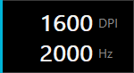
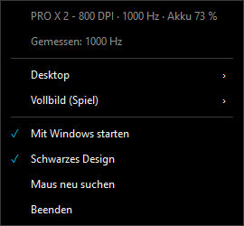

# Mausi

Kleines Programm in Rust, das DPI und Abfragerate (Hz) von Logitech-Mäusen setzt, ganz ohne G HUB. Es spricht direkt das HID++-Protokoll der Maus. Die exe ist rund 710 KB groß und braucht im Tray etwa 10 MB RAM.

Getestet mit der **PRO X Superlight 2** („PRO X 2“) am LIGHTSPEED-Empfänger (046D:C54D). Andere Logitech-Mäuse können funktionieren (siehe unten), sind aber nicht geprüft.

| Einblendung beim Wechsel von DPI oder Hz | Menü im Tray |
|---|---|
|  |  |

## Download und Start

1. `Mausi.exe` von der [Release-Seite](https://github.com/IcHiAT/mausi/releases/latest) laden und in einen eigenen Ordner legen, z. B. `%LOCALAPPDATA%\Programs\maus\`.
2. Starten. Die exe ist nicht signiert, deshalb kann Windows SmartScreen beim ersten Start warnen („Weitere Informationen“ → „Trotzdem ausführen“).
3. Im Tray: Rechtsklick auf das Symbol. „Mit Windows starten“ richtet den Autostart ein.

Läuft unter Windows 10/11, keine Installation und kein G HUB nötig. Die Benutzung erfolgt auf eigene Gefahr.

## Benutzen

| Befehl | Wirkung |
|---|---|
| `maus` | Tray-Symbol starten. Links- oder Rechtsklick öffnet das Menü mit „Desktop“ und „Vollbild (Spiel)“ (jeweils DPI und Abfragerate), „Mit Windows starten“, „Im Startmenü anzeigen“, „Schwarzes Design“, „Maus neu suchen“ und „Beenden“. |
| `maus status` | zeigt Name, DPI, Hz und die möglichen Werte |
| `maus dpi 800` | setzt die DPI (bei der PRO X 2 sind 100–44000 möglich) |
| `maus hz 1000` | setzt die Abfragerate (bei der PRO X 2: 125, 250, 500, 1000, 2000, 4000, 8000) |
| `maus liste` | listet alle Logitech-HID-Schnittstellen (zur Fehlersuche) |

- **Akku:** Der Tooltip beim Drüberfahren und die Kopfzeile des Menüs zeigen den Ladestand, beim Laden mit „(lädt)“. Der Tooltip wird alle 15 Minuten aufgefrischt. Bei 10 % oder weniger erscheint einmal ein kleines Fenster unten rechts: „Maus-Akku fast leer“. Es nimmt keinen Fokus und geht per Klick oder nach 15 Sekunden weg; Windows-Benachrichtigungen braucht es nicht. Nach dem Laden oder sobald der Akku wieder über 10 % liegt, kann der Hinweis erneut kommen. Zum Testen lässt sich die Schwelle mit der Umgebungsvariable `MAUS_WARNUNG=50` hochsetzen. Unterstützt sind die Features `0x1004` (neu) und `0x1000` (alt). `maus status` zeigt den Ladestand ebenfalls.
- **Vollbild (Spiel):** Unter „Vollbild (Spiel)“ lassen sich eigene DPI und eine eigene Abfragerate wählen; „Wie Desktop“ heißt, dass nichts umgestellt wird. maus prüft alle 2 Sekunden, ob ein Spiel im Vollbild läuft: exklusives Vollbild meldet Windows, bei randlosem Vollbild bedeckt das Vordergrundfenster den ganzen Monitor und muss zusätzlich ein Spiel sein. Als Spiel zählt, was in einem Launcher-Ordner liegt (Steam, Epic, Riot, EA, Origin, GOG, Ubisoft, XboxGames) oder sich wegen Anti-Cheat nicht abfragen lässt. Andere Spiele trägst du in `maus.ini` neben der exe ein, als Teil des Pfads oder Dateiname: `spiele = valorant.exe, D:\Spiele`. Browser und andere Programme im Vollbild stellen nichts um und blenden nichts ein. Beim Verlassen kommen die Desktop-Werte zurück. Solange ein Spiel läuft, steht im Menü „gerade aktiv“. Gespeichert wird in `zustand.txt` als `<Maus>.vollbild_dpi` und `<Maus>.vollbild_hz`.
- **Einblendung:** Beim Wechsel von DPI oder Hz (Menü oder Kommandozeile) und beim Start eines Spiels im Vollbild erscheint rechts am Bildschirmrand, vertikal mittig, ein kleines Feld mit DPI und Hz: rund 3 Sekunden mit Ein- und Ausblenden. Beim Verlassen des Vollbilds kommt es nur, wenn eigene Spielwerte zurückgestellt wurden. Es nimmt keinen Fokus und lässt Klicks durch. Echtes exklusives D3D-Vollbild kann kein Fenster überlagern. Die DPI-Taste an der Maus löst es nicht aus.
- **Schwarzes Design:** Im Menü umschaltbar, standardmäßig an. Es gilt für Menü, Eingabefeld, Akku-Hinweis und Einblendung. Gespeichert wird als `design_schwarz` in `zustand.txt`. Fehlermeldungen bleiben Standard-Windows-Fenster.
- **Eigener DPI-Wert:** Unter Desktop → DPI → „Eigener Wert …“ öffnet sich ein Eingabefeld. Enter übernimmt den Wert, Esc bricht ab.
- **Live-Hz:** Solange das Menü offen ist, zeigt die zweite Zeile die gemessene Rate, während du die Maus bewegst. Angezeigt wird der Höchstwert der letzten Sekunde. Gemessen wird über Raw Input; das Menü ist dabei im Vordergrund, deshalb drosselt Windows nicht.
- **DPI-Stufen im Tray-Menü:** Standard sind 400, 800, 1200, 1600, 3200, 6400 und dazu der aktuelle Wert. Eigene Stufen gehen über eine `maus.ini` neben der exe mit der Zeile `dpi = 400, 800, 1600`.
- **Hz-Anzeige:** Die PRO X 2 meldet nach dem Umstellen immer noch die alte Rate zurück, obwohl die echte Rate wechselt (gemessen). Deshalb merkt sich maus den zuletzt gesetzten Wert in `%LOCALAPPDATA%\maus\zustand.txt` und zeigt diesen an.
- **Onboard-Modus:** Lehnt die Maus das Setzen mit Fehler 5 ab, steht sie im Onboard-Modus. maus schaltet dann selbst auf Host-Modus (0x8100) und versucht es noch einmal.
- **G HUB:** Läuft G HUB mit, kann es beim Profilwechsel eigene Werte zurückschreiben.
- **Fehlersuche:** Mit der Umgebungsvariable `MAUS_DEBUG=1` gibt maus jede HID++-Meldung aus.

## Bauen

Benutzt wird der Rust-Toolchain `stable-x86_64-pc-windows-gnu`; MSVC ist nicht nötig:

```powershell
cargo build --release
```

Ergebnis: `target\release\maus.exe`.

- `hidapi` ist auf **2.6.3** festgelegt. Neuere Versionen ziehen windows-sys 0.61 nach. Das braucht unter dem GNU-Toolchain `dlltool` samt Assembler, und das schlägt fehl.
- Unter Linux sollte es mit `linux-native` gehen (nur Kommandozeile, kein Tray). Das ist nicht getestet.

## Andere Mäuse

maus sucht automatisch: an allen Logitech-HID++-Schnittstellen auf den Empfänger-Plätzen 1–6 und per Kabel (0xFF). Unterstützt werden diese Features:

- DPI: `0x2202` (neu) oder `0x2201` (alt)
- Abfragerate: `0x8061` (bis 8000 Hz) oder `0x8060` (alt, 125–1000 Hz)

Mäuse mit diesen Features sollten ohne Änderung laufen, getestet ist aber nur die PRO X 2.

## Name und Icon in der exe

Der Task-Manager zeigt Dateibeschreibung, Herausgeber (`-Firma`, Standard IcHiAT) und Icon der exe, im Autostart-Tab erst nach einigen Sekunden. Der GNU-Toolchain bindet keine Ressourcen ein, deshalb nach jedem Build:

```powershell
.\werkzeug\ressourcen.ps1 -Exe .\target\release\maus.exe -Ico .\assets\mausi.ico -Name Mausi -Version 0.1.1
```
